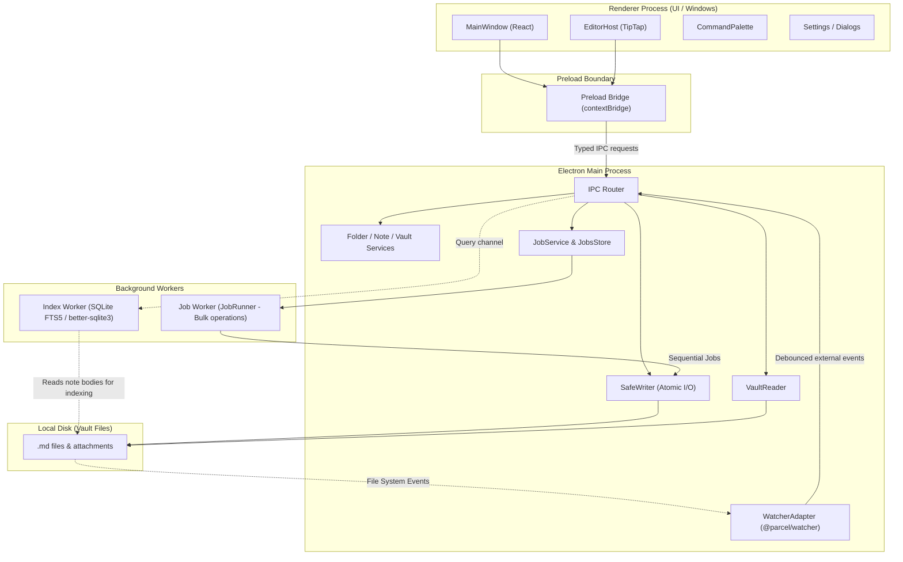

# Wrriter - Codebase Index & Architecture Map

> **Purpose:** This file provides a fast, comprehensive architectural and physical index of the Wrriter codebase. It maps directories, core responsibilities, inter-process communication (IPC) contracts, data flows, and file locations for human developers and AI agents alike.
>
> **Authority & Governance:** All work in this codebase must strictly adhere to:
> - [`ARCHITECTURE.md`](file:///c:/Dev/Wrriter/ARCHITECTURE.md) (Structural law, process boundaries, the 25 Rejection Rules)
> - [`SYSTEM.md`](file:///c:/Dev/Wrriter/SYSTEM.md) (Conventions, TypeScript rules, naming, NEVER DO list)
> - [`DONE.md`](file:///c:/Dev/Wrriter/DONE.md) (Definition of Done checklist)
> - [`UTILITIES.md`](file:///c:/Dev/Wrriter/UTILITIES.md) (Registry of reusable modules and components)
> - [`PERFORMANCE.md`](file:///c:/Dev/Wrriter/PERFORMANCE.md) (Performance budgets and hard gates)
> - [`SCHEMA.md`](file:///c:/Dev/Wrriter/SCHEMA.md) (Markdown round-trip specs, frontmatter, and disk layouts)

---

## 1. High-Level System Architecture

Wrriter is a fast, offline, privacy-first markdown note-taking desktop application for 64-bit Windows 10/11 built with **Electron**, **React**, **TypeScript**, and **Vite**.

- **Disk as Single Source of Truth:** Plain `.md` files in local vault folders. No proprietary file wrappers.
- **Strictly Offline & Zero-Telemetry:** No analytics, accounts, auto-updaters, or outbound cloud network connections.
- **Process Isolation:** Clean separation between Main, Renderer, and Background Workers.

---

## 2. Directory Breakdown & Responsibilities

### `src/shared/` — Core Pure Domain & Contracts
*Zero dependencies on Electron, Node.js filesystem, or DOM APIs. Shared across all processes.*

| File / Folder | Purpose |
|---|---|
| [`src/shared/index.ts`](file:///c:/Dev/Wrriter/src/shared/index.ts) | Public barrel export for shared utilities, contracts, domain logic. |
| [`src/shared/result.ts`](file:///c:/Dev/Wrriter/src/shared/result.ts) | Rust-style `Result<T, E>` pattern (`ok`, `err`) and `AppError` definitions. |
| [`src/shared/clock.ts`](file:///c:/Dev/Wrriter/src/shared/clock.ts) | Injectable clock abstraction (`Clock`, `SystemClock`) for deterministic testing. |
| [`src/shared/id-generator.ts`](file:///c:/Dev/Wrriter/src/shared/id-generator.ts) | Injectable ID generator (`IdGenerator`, `SystemIdGenerator`). |
| [`src/shared/shortcuts.ts`](file:///c:/Dev/Wrriter/src/shared/shortcuts.ts) | Keyboard shortcut matcher and normalization. |
| **`src/shared/domain/`** | |
| [`src/shared/domain/frontmatter.ts`](file:///c:/Dev/Wrriter/src/shared/domain/frontmatter.ts) | Safe frontmatter extraction and parsing without raw `eval` or unsafe YAML. |
| [`src/shared/domain/names.ts`](file:///c:/Dev/Wrriter/src/shared/domain/names.ts) | Windows-safe file/folder name sanitization, collisions, reserved character rules. |
| [`src/shared/domain/ordering.ts`](file:///c:/Dev/Wrriter/src/shared/domain/ordering.ts) | Natural sort order, pinned notes, custom order positioning. |
| [`src/shared/domain/titles.ts`](file:///c:/Dev/Wrriter/src/shared/domain/titles.ts) | Default title generator, first-line title extraction, file rename logic on title leave, note preview text and first-image extraction. |
| **`src/shared/ipc/`** | |
| [`src/shared/ipc/contracts.ts`](file:///c:/Dev/Wrriter/src/shared/ipc/contracts.ts) | Complete types and payload contracts for all IPC calls (`window.*`, `note.*`, `folder.*`, `vault.*`, `index.*`). |
| [`src/shared/ipc/validators.ts`](file:///c:/Dev/Wrriter/src/shared/ipc/validators.ts) | Runtime type validation for external data arriving over the IPC boundary. |
| [`src/shared/ipc/index.ts`](file:///c:/Dev/Wrriter/src/shared/ipc/index.ts) | Barrel export for IPC contracts and validators. |
| **`src/shared/markdown/`** | |
| [`src/shared/markdown/blocks.ts`](file:///c:/Dev/Wrriter/src/shared/markdown/blocks.ts) | Markdown block splitter (paragraph, code, callout, table, list) for surgical updates. |
| [`src/shared/markdown/save.ts`](file:///c:/Dev/Wrriter/src/shared/markdown/save.ts) | `planSave`: diffs blocks between disk and editor to minimize I/O and preserve whitespace. |
| [`src/shared/markdown/pass-through.ts`](file:///c:/Dev/Wrriter/src/shared/markdown/pass-through.ts) | Handling and preserving untouched markdown syntax (e.g., math, mermaid, HTML comments). |

---

### `src/main/` — Electron Main Process
*Owns app lifecycle, native window orchestration, tray, file I/O safety, and background workers.*

| File / Folder | Purpose |
|---|---|
| [`src/main/index.ts`](file:///c:/Dev/Wrriter/src/main/index.ts) | Application entry point: single-instance lock, window setup, worker initialization, IPC router registration. |
| **`src/main/services/`** | Core backend services |
| [`src/main/services/safe-writer.ts`](file:///c:/Dev/Wrriter/src/main/services/safe-writer.ts) | Atomic file writer: temporary dotfile write, sync to disk, atomic rename, locked-file backoff, write-memory cache. |
| [`src/main/services/vault-reader.ts`](file:///c:/Dev/Wrriter/src/main/services/vault-reader.ts) | Vault file reading, directory walking, security checks, and note preview/image extraction. |
| [`src/main/services/vault-service.ts`](file:///c:/Dev/Wrriter/src/main/services/vault-service.ts) | Vault switching, opening, creation, recents tracking, metadata caching. |
| [`src/main/services/note-service.ts`](file:///c:/Dev/Wrriter/src/main/services/note-service.ts) | Note CRUD operations, note saving through `SafeWriter`, note rename/delete. |
| [`src/main/services/folder-service.ts`](file:///c:/Dev/Wrriter/src/main/services/folder-service.ts) | Folder tree hierarchy discovery, folder creation, folder renames/moves. |
| [`src/main/services/order-service.ts`](file:///c:/Dev/Wrriter/src/main/services/order-service.ts) | Manual drag-and-drop sort orders persisted in `.wrriter/order.json`. |
| [`src/main/services/job-service.ts`](file:///c:/Dev/Wrriter/src/main/services/job-service.ts) | Coordinates background bulk tasks via `JobRunner` with resumable progress tracking. |
| [`src/main/services/watcher-adapter.ts`](file:///c:/Dev/Wrriter/src/main/services/watcher-adapter.ts) | Integrates `@parcel/watcher` with debounce and self-write suppression (`SafeWriter.isRecentlyWritten`). |
| [`src/main/services/window-service.ts`](file:///c:/Dev/Wrriter/src/main/services/window-service.ts) | Manages BrowserWindow instances, dimensions, state persistence, first paint coordinates. |
| **`src/main/store/`** | Persistent configuration stores |
| [`src/main/store/app-data-store.ts`](file:///c:/Dev/Wrriter/src/main/store/app-data-store.ts) | Persists global settings (theme, accent, window bounds, recent vaults) in `%APPDATA%/Wrriter`. |
| [`src/main/store/jobs-store.ts`](file:///c:/Dev/Wrriter/src/main/store/jobs-store.ts) | Resumable journal for pending/interrupted bulk disk jobs (`.wrriter/jobs.json`). |
| **`src/main/platform/`** | Windows platform integration |
| [`src/main/platform/vault-protocol.ts`](file:///c:/Dev/Wrriter/src/main/platform/vault-protocol.ts) | Custom `vault://` protocol handler to safely stream local images/attachments to renderer without `file://`. |
| [`src/main/platform/recycle-bin.ts`](file:///c:/Dev/Wrriter/src/main/platform/recycle-bin.ts) | Safe note deletion via Windows Recycle Bin (`shell.trashItem`). |
| [`src/main/platform/lag-monitor.ts`](file:///c:/Dev/Wrriter/src/main/platform/lag-monitor.ts) | Node event loop lag measurement to ensure responsiveness budgets. |
| **`src/main/windows/`** | |
| [`src/main/windows/window-factory.ts`](file:///c:/Dev/Wrriter/src/main/windows/window-factory.ts) | Constructs native `BrowserWindow` instances with security hardening (context isolation, sandbox). |
| **`src/main/ipc/`** | |
| [`src/main/ipc/router.ts`](file:///c:/Dev/Wrriter/src/main/ipc/router.ts) | Wires IPC channels (`ipcMain.handle`) to respective services with validator enforcement. |

---

### `src/preload/` — Security Boundary
| File | Purpose |
|---|---|
| [`src/preload/index.ts`](file:///c:/Dev/Wrriter/src/preload/index.ts) | Implements `contextBridge.exposeInMainWorld('wrriter', ...)` exposing strictly validated API surface to React. |

---

### `src/renderer/` — React UI & TipTap Editor
*Clean, token-driven, offline UI adhering to 4.5:1 contrast, 300 ms motion ceilings, and strict layout rules.*

| File / Folder | Purpose |
|---|---|
| [`src/renderer/windows/main/MainWindow.tsx`](file:///c:/Dev/Wrriter/src/renderer/windows/main/MainWindow.tsx) | The primary application container: 3-pane layout (sidebar, note list, editor), tabs, modals. |
| [`src/renderer/windows/main/index.tsx`](file:///c:/Dev/Wrriter/src/renderer/windows/main/index.tsx) | React DOM root mount point. |
| [`src/renderer/windows/main/index.html`](file:///c:/Dev/Wrriter/src/renderer/windows/main/index.html) | HTML document for the main window. |
| **`src/renderer/editor/`** | TipTap WYSIWYG Editor System |
| [`src/renderer/editor/EditorHost.tsx`](file:///c:/Dev/Wrriter/src/renderer/editor/EditorHost.tsx) | Primary editor view: initializes TipTap, wires extensions, floating menus, block handles, auto-saving. |
| [`src/renderer/editor/markdown-converter.ts`](file:///c:/Dev/Wrriter/src/renderer/editor/markdown-converter.ts) | Bidirectional converter between TipTap ProseMirror document and markdown string. |
| [`src/renderer/editor/find-replace-core.ts`](file:///c:/Dev/Wrriter/src/renderer/editor/find-replace-core.ts) | High-speed find & replace engine meeting 1 MB / 5,000 matches performance gate. |
| **`src/renderer/editor/extensions/`** | TipTap ProseMirror Extensions |
| [`.../extensions/nodes.ts`](file:///c:/Dev/Wrriter/src/renderer/editor/extensions/nodes.ts) | Custom block nodes: paragraphs, headings, task lists, code blocks, quotes. |
| [`.../extensions/marks.ts`](file:///c:/Dev/Wrriter/src/renderer/editor/extensions/marks.ts) | Formatting marks: bold, italic, strikethrough, inline code. |
| [`.../extensions/callout.ts`](file:///c:/Dev/Wrriter/src/renderer/editor/extensions/callout.ts) | Callout blocks (`[!NOTE]`, `[!TIP]`, `[!WARNING]`, etc.) with icon rendering. |
| [`.../extensions/table.ts`](file:///c:/Dev/Wrriter/src/renderer/editor/extensions/table.ts) | Markdown table node rendering and keyboard navigation. |
| [`.../extensions/image.ts`](file:///c:/Dev/Wrriter/src/renderer/editor/extensions/image.ts) | Image embeds via `vault://` protocol with width and alignment controls. |
| [`.../extensions/file-chip.ts`](file:///c:/Dev/Wrriter/src/renderer/editor/extensions/file-chip.ts) | Non-image attachment chip representation. |
| [`.../extensions/links.ts`](file:///c:/Dev/Wrriter/src/renderer/editor/extensions/links.ts) | Internal Wikilinks (`[[Note Name]]`) and external web links. |
| [`.../extensions/markdown-shortcuts.ts`](file:///c:/Dev/Wrriter/src/renderer/editor/extensions/markdown-shortcuts.ts) | Live markdown input rules (`# `, `- [ ] `, `> `, etc.). |
| [`.../extensions/slash-menu.ts`](file:///c:/Dev/Wrriter/src/renderer/editor/extensions/slash-menu.ts) | Slash command popup trigger and state machine. |
| [`.../extensions/slash-menu-items.ts`](file:///c:/Dev/Wrriter/src/renderer/editor/extensions/slash-menu-items.ts) | Item list and icons for the slash menu. |
| [`.../extensions/floating-toolbar.ts`](file:///c:/Dev/Wrriter/src/renderer/editor/extensions/floating-toolbar.ts) | Text selection floating formatting toolbar. |
| [`.../extensions/block-handles.ts`](file:///c:/Dev/Wrriter/src/renderer/editor/extensions/block-handles.ts) | Hover block drag handle & action trigger. |
| [`.../extensions/block-drag.ts`](file:///c:/Dev/Wrriter/src/renderer/editor/extensions/block-drag.ts) | Drag-and-drop block reordering. |
| [`.../extensions/heading-folding.ts`](file:///c:/Dev/Wrriter/src/renderer/editor/extensions/heading-folding.ts) | Collapsible headings state and decorations. |
| [`.../extensions/typing-touches.ts`](file:///c:/Dev/Wrriter/src/renderer/editor/extensions/typing-touches.ts) | Typing touches / caret motion dynamics (sub-8ms latency gate). |
| **`src/renderer/components/`** | UI Components |
| [`.../components/WindowShell.tsx`](file:///c:/Dev/Wrriter/src/renderer/components/WindowShell.tsx) | Frameless window header with custom minimize, maximize, and close controls. |
| [`.../components/FolderTree.tsx`](file:///c:/Dev/Wrriter/src/renderer/components/FolderTree.tsx) | Left sidebar folder navigation tree. |
| [`.../components/VirtualList.tsx`](file:///c:/Dev/Wrriter/src/renderer/components/VirtualList.tsx) | High-performance virtualized list for note lists of any size. |
| [`.../components/NoteRow.tsx`](file:///c:/Dev/Wrriter/src/renderer/components/NoteRow.tsx) | Individual note row item with pin status, modified timestamp, title, preview snippet, and first-image thumbnail. |
| [`.../components/TabStrip.tsx`](file:///c:/Dev/Wrriter/src/renderer/components/TabStrip.tsx) | Note tabs strip above the editor. |
| [`.../components/CommandPalette.tsx`](file:///c:/Dev/Wrriter/src/renderer/components/CommandPalette.tsx) | Quick command switcher (`Ctrl+P` / `Ctrl+Shift+P`). |
| [`.../components/SettingsWindow.tsx`](file:///c:/Dev/Wrriter/src/renderer/components/SettingsWindow.tsx) | Settings modal for themes, accents, and preferences. |
| [`.../components/Notice.tsx`](file:///c:/Dev/Wrriter/src/renderer/components/Notice.tsx) | Non-blocking toast notifications. |
| [`.../components/Dialog.tsx`](file:///c:/Dev/Wrriter/src/renderer/components/Dialog.tsx) | Accessible modal confirmation dialogs. |
| **`src/renderer/styles/` & `motion/`** | Visual System |
| [`src/renderer/styles/tokens.css`](file:///c:/Dev/Wrriter/src/renderer/styles/tokens.css) | Complete design token registry (colors, 5 accents, 3 font stacks, spacing, elevation). |
| [`src/renderer/styles/components.css`](file:///c:/Dev/Wrriter/src/renderer/styles/components.css) | Scoped component styling adhering strictly to CSS variables. |
| [`src/renderer/motion/index.ts`](file:///c:/Dev/Wrriter/src/renderer/motion/index.ts) | Animation tokens (durations <= 300 ms, approved easing curves). |
| [`src/renderer/motion/theme-transition.ts`](file:///c:/Dev/Wrriter/src/renderer/motion/theme-transition.ts) | Smooth cross-fade transition on theme changes. |

---

### `src/workers/` — Background Task Workers
*Independent worker threads preventing main and UI thread starvation.*

| Worker | File | Purpose |
|---|---|---|
| **Index Worker** | [`src/workers/index/index.ts`](file:///c:/Dev/Wrriter/src/workers/index/index.ts) | Sole owner of SQLite FTS5 index via `better-sqlite3`. Indexes notes, handles full-text search and title queries. |
| **Job Worker** | [`src/workers/jobs/index.ts`](file:///c:/Dev/Wrriter/src/workers/jobs/index.ts) | Background execution environment for disk-heavy batch operations. |
| | [`src/workers/jobs/job-runner.ts`](file:///c:/Dev/Wrriter/src/workers/jobs/job-runner.ts) | Concurrent job runner (4 to 8 parallel workers) for bulk renames, folder moves, and link refactors. |

---

## 3. Tooling, Verification, and Scripts

All checks are executed prior to builds and gated in CI/tests (`npm run check`):

| Script | Purpose |
|---|---|
| [`scripts/check-rules.mjs`](file:///c:/Dev/Wrriter/scripts/check-rules.mjs) | Validates architecture layer boundaries and bans forbidden cross-layer imports. |
| [`scripts/check-tokens.mjs`](file:///c:/Dev/Wrriter/scripts/check-tokens.mjs) | Verifies every CSS color, font, and spacing rule uses defined design tokens. |
| [`scripts/check-contrast.mjs`](file:///c:/Dev/Wrriter/scripts/check-contrast.mjs) | Ensures WCAG AA contrast (>= 4.5:1 for text, >= 3.0:1 for graphical/accent elements). |
| [`scripts/check-motion.mjs`](file:///c:/Dev/Wrriter/scripts/check-motion.mjs) | Asserts no animation or transition exceeds the 300 ms ceiling and conforms to motion tokens. |
| [`scripts/check-dash.mjs`](file:///c:/Dev/Wrriter/scripts/check-dash.mjs) | Forbids typographical en-dash or em-dash in UI copy (per writing guidelines). |
| [`scripts/size-report.mjs`](file:///c:/Dev/Wrriter/scripts/size-report.mjs) | Analyzes bundle sizes against memory and size limits. |

---

## 4. Test Suites Map

| Test Suite | Location | What It Verifies |
|---|---|---|
| **Round-Trip Samples** | [`tests/samples/round-trip.test.ts`](file:///c:/Dev/Wrriter/tests/samples/round-trip.test.ts) | 21 real-world sample markdown notes round-trip without loss of content or formatting. |
| **SafeWriter & I/O** | [`tests/main/safe-writer.test.ts`](file:///c:/Dev/Wrriter/tests/main/safe-writer.test.ts) | Atomic writes, power-cut kill simulation (100 iterations), temp file cleanup, locked retries. |
| **Editor Performance** | [`tests/renderer/find-replace.test.ts`](file:///c:/Dev/Wrriter/tests/renderer/find-replace.test.ts) | 5,000 matches in a 1 MB document find/replace within 1,000 ms. |
| **Typing Latency** | [`tests/renderer/typing-touches.test.ts`](file:///c:/Dev/Wrriter/tests/renderer/typing-touches.test.ts) | Key press to letter latency in 1 MB note within budget (median < 8 ms, 99th < 16 ms). |
| **Jobs & Resilience** | [`tests/main/job-service.test.ts`](file:///c:/Dev/Wrriter/tests/main/job-service.test.ts) | Resumes interrupted bulk jobs without undoing or corrupting completed work. |
| **Domain Logic** | [`tests/shared/`](file:///c:/Dev/Wrriter/tests/shared) | Unit tests for blocks, clock, frontmatter, id generation, IPC validators, names, ordering, and titles. |
| **Vault Generator** | [`tests/vault-gen/`](file:///c:/Dev/Wrriter/tests/vault-gen) | Generates synthetic 10k-note vaults for scale and stress testing. |
| **Empty Folder & Count Regression** | [`tests/renderer/folder-empty-note-leak-regression.test.ts`](file:///c:/Dev/Wrriter/tests/renderer/folder-empty-note-leak-regression.test.ts) | Prevents active note retention leaking across folder boundaries and decouples root folder count badge from filtered list state. |
| **Note Deletion Regression** | [`tests/renderer/note-deletion-anomalies-regression.test.ts`](file:///c:/Dev/Wrriter/tests/renderer/note-deletion-anomalies-regression.test.ts) | Verifies deletion note removal, immediate selection update, tab eviction on internal delete, and notice auto-dismissal. |
| **List Jump & Scrollbar Regression** | [`tests/renderer/list-jump-scrollbar-regression.test.ts`](file:///c:/Dev/Wrriter/tests/renderer/list-jump-scrollbar-regression.test.ts) | Verifies polling equality bailouts, short-list virtual scroll pinning (preventing phantom translations), and dark theme scrollbar styling on note list rows. |
| **Note Title Trail Regression** | [`tests/renderer/note-title-trail-regression.test.ts`](file:///c:/Dev/Wrriter/tests/renderer/note-title-trail-regression.test.ts) | Verifies synchronous flush of live title updates, suppression of redundant IPC during typing, and layout reflow bypass in VirtualList. |
| **Folder Inline Creation** | [`tests/renderer/folder-creation-inline.test.tsx`](file:///c:/Dev/Wrriter/tests/renderer/folder-creation-inline.test.tsx) | Verifies root-level folder inline creation via header plus icon and subfolder creation via context menu with Windows name validation. |
| **Folder Context Menu Regression** | [`tests/renderer/folder-context-menu-regression.test.tsx`](file:///c:/Dev/Wrriter/tests/renderer/folder-context-menu-regression.test.tsx) | Verifies FolderTree passes `menuId="folder-context-menu"` to prevent self-closing collision with `wrriter:close-all-menus`. |
| **Folder Icon Empty Parent Regression** | [`tests/renderer/folder-icon-empty-parent-regression.test.tsx`](file:///c:/Dev/Wrriter/tests/renderer/folder-icon-empty-parent-regression.test.tsx) | Verifies leaf folders without children never receive the `.open` class and retain their closed folder icon when subfolders are deleted. |

---

## 5. Architectural Invariants (The "Never Do" Rules)

1. **NEVER touch disk directly from the Renderer:** All disk operations must go through `window.wrriter` IPC channels to `SafeWriter` / `VaultReader`.
2. **NEVER touch SQLite outside the Index Worker:** Neither Main nor Renderer may open or query the SQLite index database directly.
3. **NEVER make outbound network requests:** Wrriter is 100% offline. No telemetry, no update checks, no cloud APIs.
4. **NEVER destroy user markdown formatting:** Markdown edits must round-trip cleanly; untouched blocks must remain bite-for-byte identical.
5. **NEVER block the UI thread:** Any job touching multiple files must run in the background Job Worker with progress reporting.
