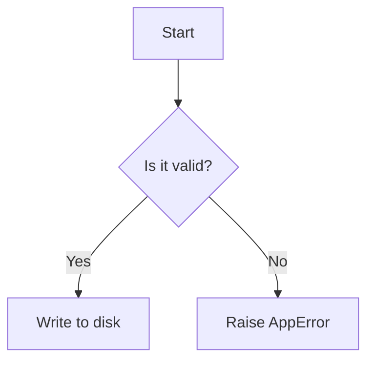

# Maths and Mermaid Blocks

Here is a block math equation:

$$
e^{i\pi} + 1 = 0
$$

And an inline math expression: $f(x) = x^2 + 2x + 1$ inside text.

Here is a Mermaid flowchart diagram:

These blocks are preserved exactly as written.
